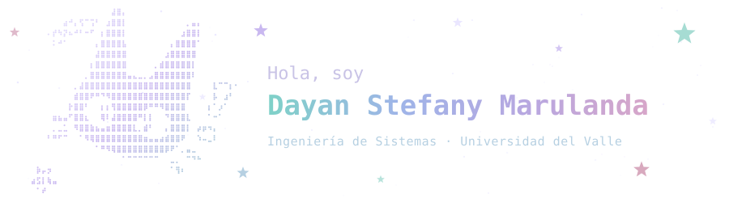
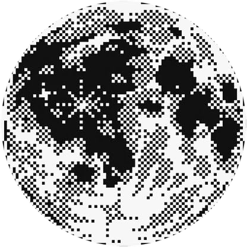

  

˚ . ✦ . ˚ . ⋆ . ˚ . ✧ . ˚ . ⋆ . ˚ . ✦ . ˚

  Estudiante de Ingeniería de Sistemas en la Universidad del Valle, cursando quinto semestre. 
  Me interesa construir software bien diseñado y seguir aprendiendo cosas nuevas por mi cuenta.

˚ . ✦ . ˚ . ⋆ . ˚ . ✧ . ˚ . ⋆ . ˚ . ✦ . ˚

## ✦ Sobre mí

- ✧ Estudio Ingeniería de Sistemas en la Universidad del Valle.
- ✧ Actualmente aprendo gestión de proyectos, Scrum, diseño de software, bases de datos y más.
- ✧ Estoy en constante aprendizaje, llena de curiosidad por adquirir nuevo conocimiento.
- ✧ Busco mejorar mis habilidades como desarrolladora.

 

## ✦ Lenguajes que conozco y estoy aprendiendo

  
  
  
  
  
  
  

## ✦ Herramientas

  
  
  
  
  
  
  
  
  
  
  

## ✦ Contacto

 

✧ Correo institucional: [dayan.marulanda@correounivalle.edu.co](mailto:dayan.marulanda@correounivalle.edu.co)

 

˚ . ✦ . ˚ . ⋆ . ˚ . ✧ . ˚ . ⋆ . ˚ . ✦ . ˚

